<p align="center">
  
</p>

<h1 align="center">译幕 Voxtitle</h1>

<p align="center">
  会自己听写、翻译、朗读字幕的安卓视频播放器
</p>

<p align="center">
  <a href="https://github.com/clusflah/ai-subtitle-player/releases/latest">下载最新版</a> ·
  <a href="#快速上手">快速上手</a> ·
  <a href="#功能详解">功能详解</a> ·
  <a href="#常见问题">常见问题</a>
</p>

---

没有字幕的视频，用语音识别现场生成带时间轴的字幕；外语字幕，交给大模型翻译成双语；想用耳朵听，还能按角色配音朗读译文。播放器本身仿 VLC 设计，本地文件、NAS、网盘、Emby / Plex 媒体服务器都能直接打开。

## 功能特点

**AI 字幕**
- 🎙️ **语音识别生成字幕**：8 种本地离线模型（免费、不联网）+ 7 家云端服务，边识别边显示，按逐字时间戳切成适合阅读的短句
- 🌐 **大模型翻译**：Claude、DeepSeek、Gemini、免费的 Index-Translate，或任意 OpenAI 兼容接口；结合上下文翻译，人名前后一致；模型列表可在线获取、下拉选择
- 🧠 **聪明地省钱**：原文已经是目标语言的句子（例如看中文视频）不发给大模型，直接显示原文；简体 ↔ 繁体仍会转换
- 🔤 **拼音标注**：中文译文可在每个字上方标注带声调的拼音，适合学中文
- 🗣️ **朗读译文**：跟随字幕时间朗读，大模型识别说话角色，每个角色配不同的声音
- 🎞️ **视频自带字幕直接翻译**：MKV / MP4 里的外语字幕轨可以直接读出来翻译，比语音识别更准；自带字幕和 AI 字幕可以分别开关显示
- 🔗 **分享链接即看（下载版）**：在 YouTube、B 站等 App 里分享给译幕，自动下载视频、准备字幕（平台字幕优先，没有就 AI 识别）、翻译并播放
- 📥 **已有字幕**：导入 SRT / VTT / ASS，或从射手网、OpenSubtitles 在线下载；可导出双语 / 译文 / 原文 SRT

**播放器**
- 仿 VLC 的界面与手势：双击快进快退、滑动调亮度音量、长按 2 倍速
- 拖动进度条显示画面预览；按章节（MKV、DVD / 蓝光）或均分的片段预览图跳转
- 片头片尾：读取章节名里的 OP / ED，或和同一部剧的另一集比对声音自动找出；也可以自己标记跳过区间，自动跳过或显示「跳过」按钮
- 音轨和视频自带字幕按首选语言自动选择，每个视频选过的轨道都会记住
- 暂停后逐帧前进 / 后退，截图存相册，书签记下位置和画面（关键帧集合可一次存到相册）
- 双语字幕的译文行、原文行分别调字号、颜色、底板、粗细，可交换上下顺序，上面那行可以单独放到画面顶部
- 倍速、睡眠计时器、A-B 循环、均衡器、仅播放声音、画中画、锁屏、跳转到指定时间
- ExoPlayer 内核为主；DVD / 蓝光 ISO 镜像和疑难格式自动换用 VLC 内核
- 播放队列、播放列表、播放历史，记住每个视频的播放进度
- 播放音乐时显示封面和滚动歌词：读取内嵌歌词、封面，没有时自动从 LRCLIB、网易云音乐、iTunes 查找，也可以手动搜索、导入 LRC

**媒体来源**
- 手机媒体库、系统文件选择器、网络串流地址（HLS / DASH / RTSP）
- 电视直播：添加 M3U / M3U8 或「频道名,地址」TXT 直播源，按分组浏览、搜索，播放时一键切台
- WebDAV、OpenList（AList）；可同时填内网和外网地址，在家自动走局域网
- 直连网盘：115、阿里云盘、百度网盘、PikPak、OneDrive、Dropbox、Google Drive
- 媒体服务器：Emby / Jellyfin、Plex（海报墙浏览）

**影视信息与文件管理**
- 详情页显示简介、海报、演职员、评分：优先读取视频旁的 NFO 和图片，缺的再从 TMDB、豆瓣、Bangumi、TheTVDB、Fanart.tv 补全
- 文件重命名、移动、复制、删除、分享、多选；网络位置和网盘可新建文件夹、删除、下载（保留目录结构）

## 截图

| 视频 | 音频 | 浏览 | 更多 |
|---|---|---|---|
| 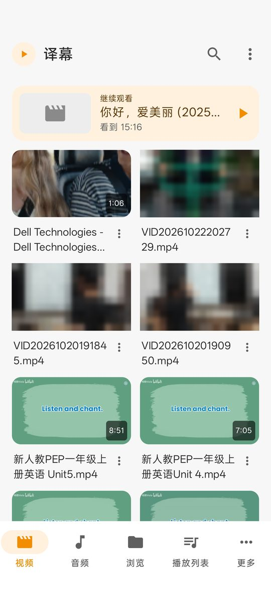 | 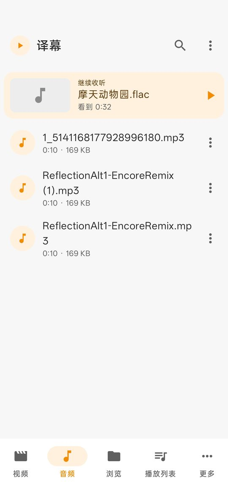 | 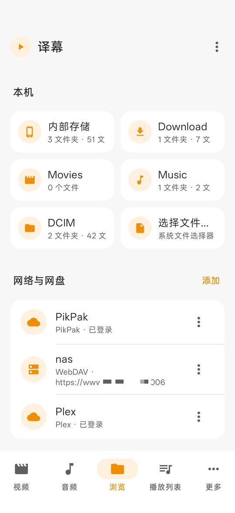 | 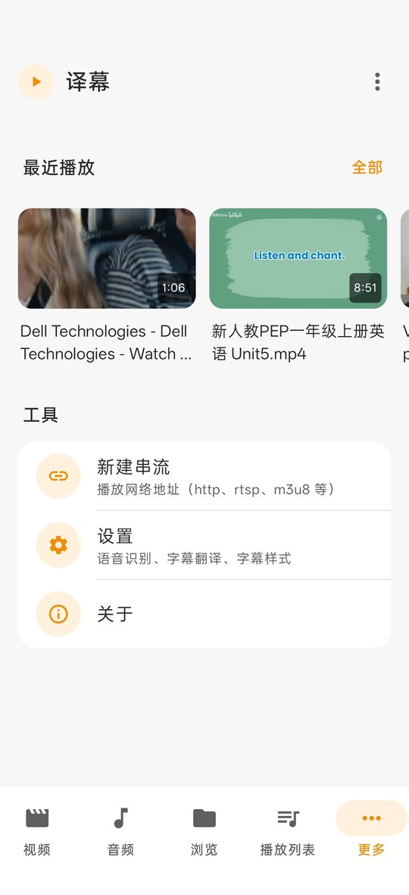 |

| 字幕面板（双语、拼音、朗读、角色） | 播放器「更多」菜单 | 在线下载字幕 | 影视详情 |
|---|---|---|---|
| 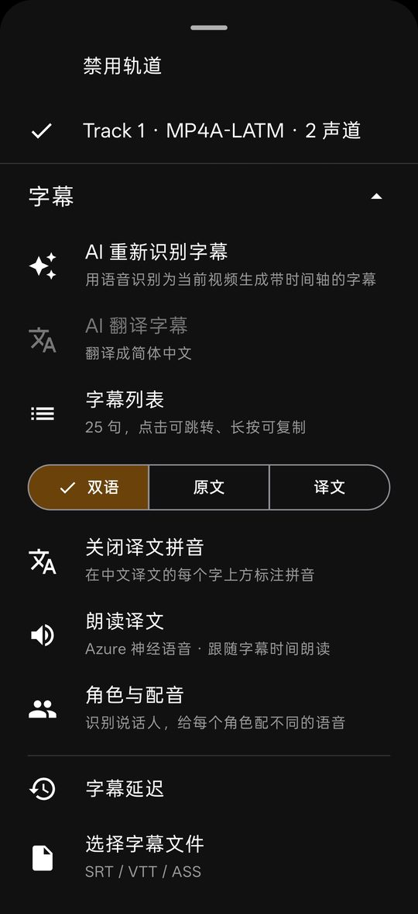 | 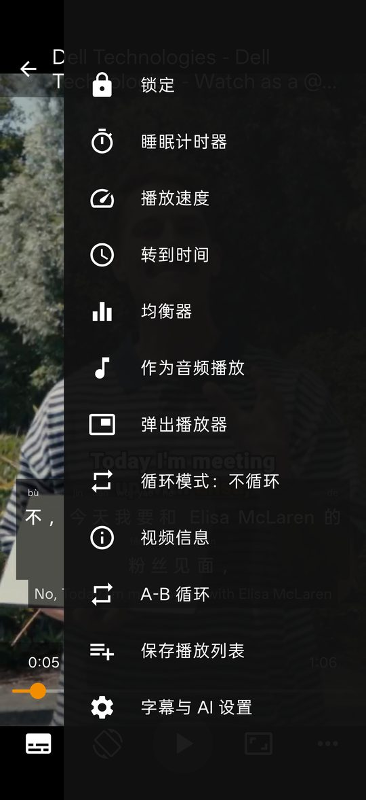 | 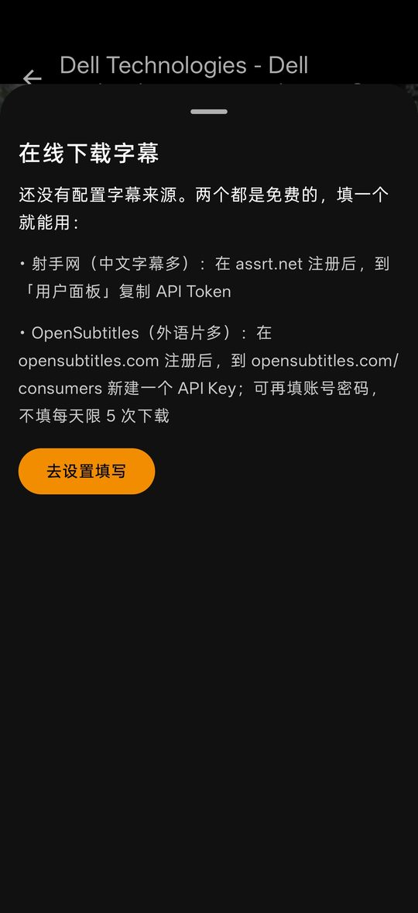 |  |

| 本地识别模型 | 翻译服务 | 拼音字幕预览 | 朗读设置 |
|---|---|---|---|
| 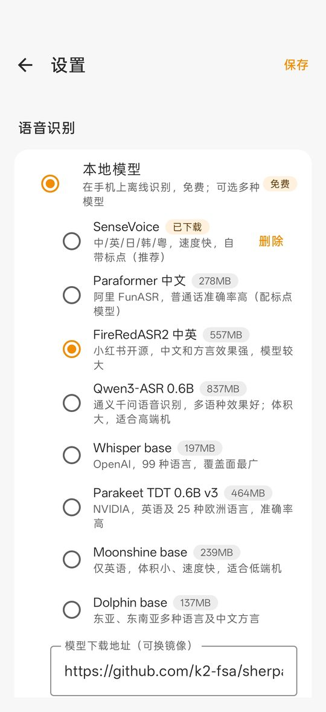 | 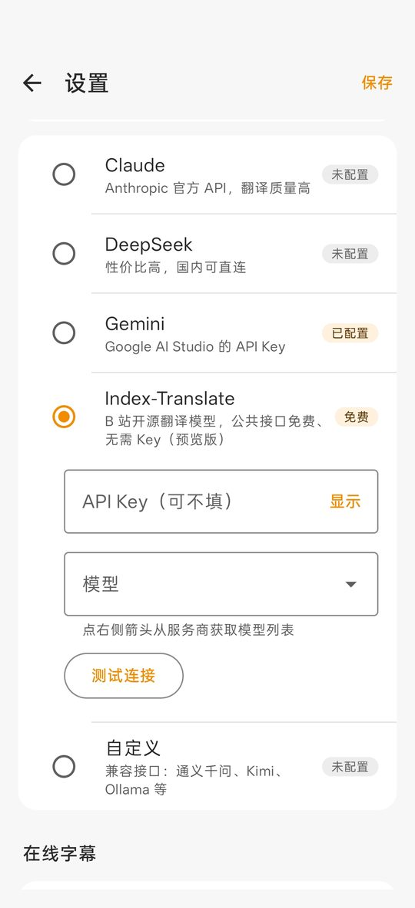 | 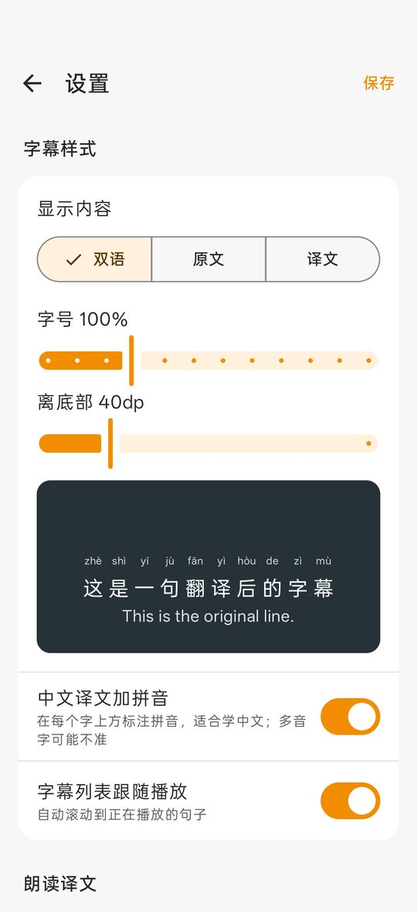 | 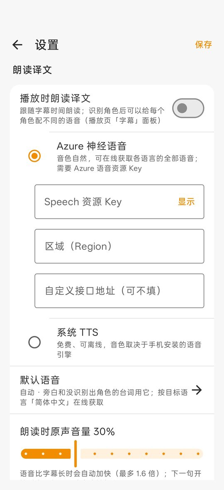 |

<details>
<summary>更多截图</summary>

| 添加网盘与媒体服务器 | 云端识别（Azure） | 云端识别服务 | 目标语言 |
|---|---|---|---|
| 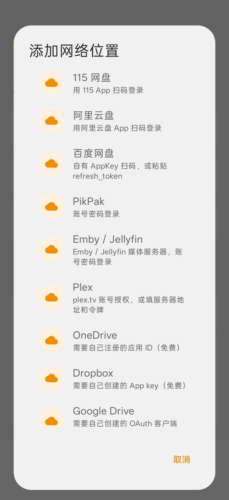 | 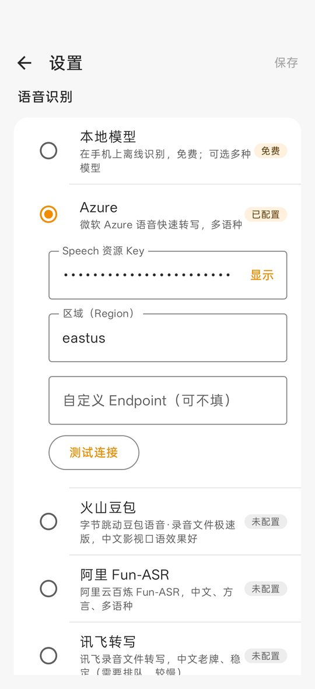 | 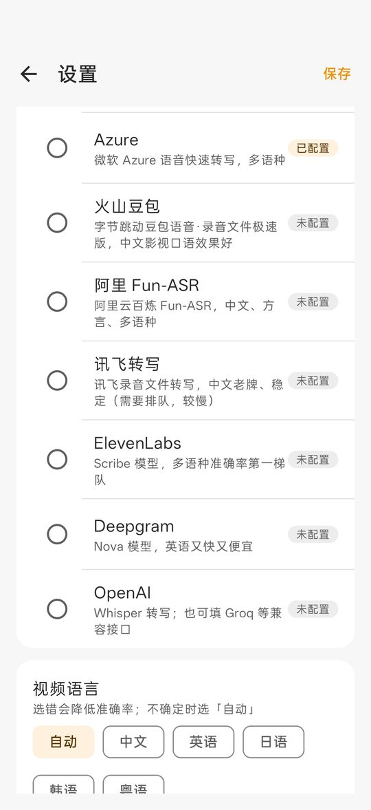 | 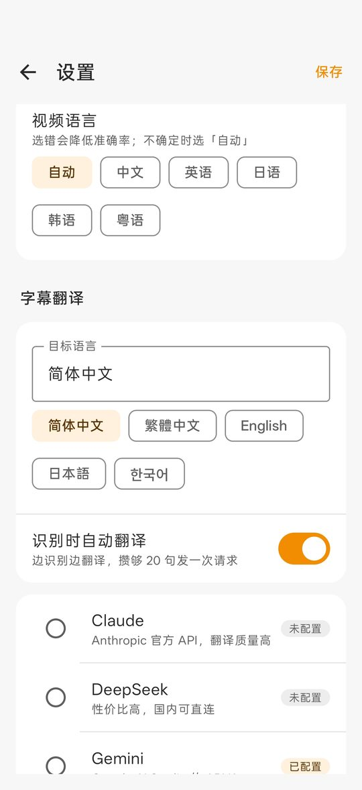 |

| 影视信息来源 | TheTVDB / Fanart.tv | 在线字幕来源 | 音轨与字幕 |
|---|---|---|---|
| 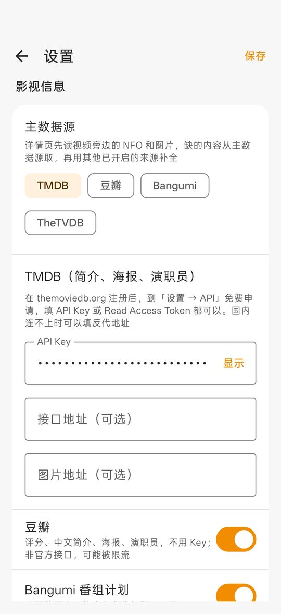 | 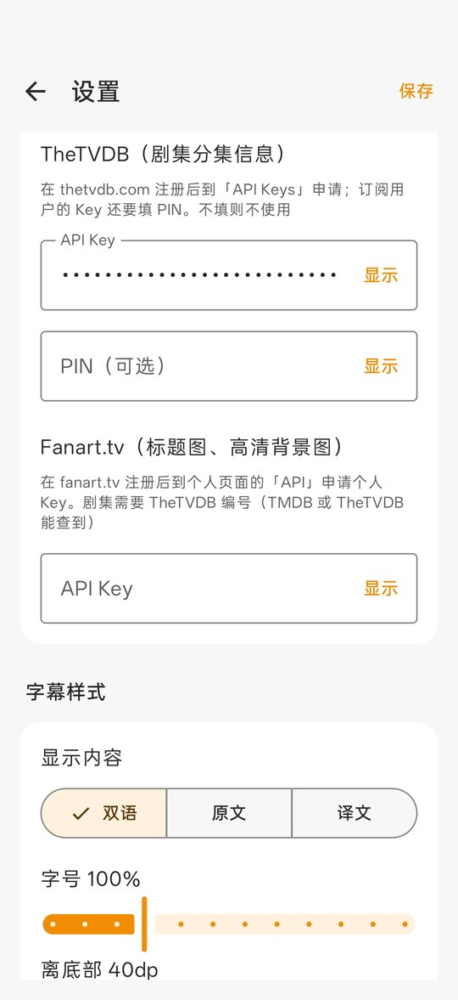 | 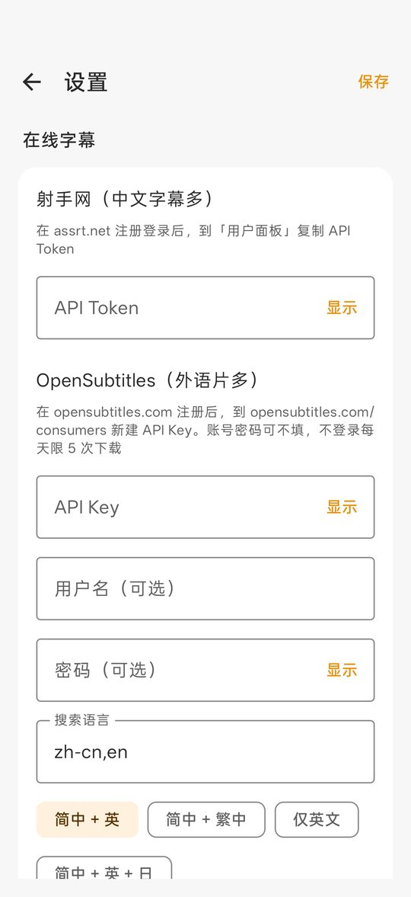 | 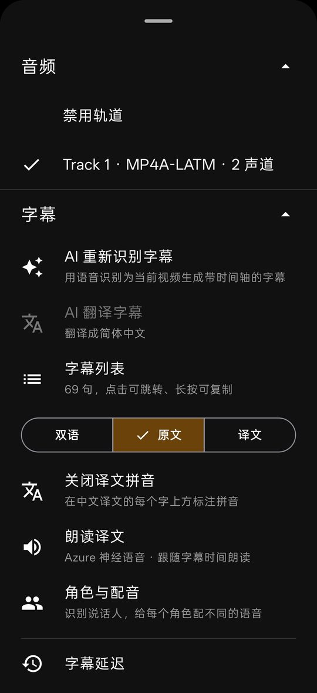 |

</details>

## 快速上手

1. **安装**：到 [Releases](https://github.com/clusflah/ai-subtitle-player/releases/latest) 下载 APK。大多数手机选 `Voxtitle-*-arm64-v8a.apk`，不确定就选 `universal`。需要 Android 8.0 及以上。
2. **打开视频**：在「视频」标签里选一个视频，或者在文件管理器里「用其他应用打开」。
3. **生成字幕**：播放页点左下角「字幕与音轨」→「AI 字幕」→「语音识别生成字幕」。默认用本地 SenseVoice 模型，第一次会下载约 160 MB 的模型，之后完全离线。
4. **翻译**：到「设置 → 字幕翻译」选一个翻译服务。想零成本试用就选 **Index-Translate**（免费、无需 Key）。开启「识别时自动翻译」后，识别和翻译会同时进行。
5. **看双语字幕**：字幕面板里选「双语 / 原文 / 译文」，设置里还能调字号和位置。

> 识别是从头往后进行的。拖到还没识别到的位置时暂时没有字幕，等识别跟上即可。识别结果按视频缓存，下次打开直接加载。

## 功能详解

### 语音识别

在「设置 → 语音识别」选择引擎，并在下方「视频语言」里选择视频的语言（不确定选「自动」）：常用的 20 种语言和四川话可以直接选，其他语言点「自定义…」填语言代码（如 sv、cs、pt-BR）；所选引擎或本地模型不支持该语言时会有红字提示。这里是默认语言；在播放页「AI 字幕」的「语音语言」里可以给单个视频另选，只对那个视频生效。四川话：Azure、讯飞（需在控制台开通西南官话）、豆包和本地 Qwen3-ASR、Dolphin、FireRedASR2 支持方言识别，其他引擎按普通话识别。

**本地模型**（免费、离线，首次使用时下载；国内网络慢可在设置里把下载地址换成镜像）

<p> </p>

| 模型 | 适合 | 大小 |
|---|---|---|
| SenseVoice（推荐） | 中 / 英 / 日 / 韩 / 粤，速度快，自带标点 | 约 160 MB |
| Paraformer 中文 | 普通话准确率高（配标点模型） | 约 280 MB |
| FireRedASR2 中英 | 中文和方言效果强 | 约 560 MB |
| Qwen3-ASR 0.6B | 多语种效果好，适合高端机 | 约 840 MB |
| Whisper base | 99 种语言，覆盖面最广 | 约 200 MB |
| Parakeet TDT 0.6B v3 | 英语及 25 种欧洲语言 | 约 460 MB |
| Moonshine base | 仅英语，体积小、速度快，适合低端机 | 约 240 MB |
| Dolphin base | 东亚、东南亚语言及中文方言 | 约 140 MB |

**云端服务**（填写各家的 API Key，设置里每个都有「测试连接」）

| 服务 | 特点 |
|---|---|
| Azure | 微软快速转写，多语种 |
| 火山豆包 | 中文影视口语效果好 |
| 阿里 Fun-ASR | 中文、方言、多语种 |
| 讯飞转写 | 老牌稳定，需要排队，较慢 |
| ElevenLabs Scribe | 多语种准确率第一梯队 |
| Deepgram | 英语又快又便宜 |
| OpenAI Whisper | 也可填 Groq 等兼容接口 |

### 字幕翻译

<p> </p>

在「设置 → 字幕翻译」选择服务、填 API Key，点「模型」输入框右侧的箭头可以从服务商**在线获取模型列表**下拉选择，也可以手动填。

| 服务 | 说明 |
|---|---|
| Claude | Anthropic 官方 API，翻译质量高 |
| DeepSeek | 性价比高，国内可直连 |
| Gemini | Google AI Studio 的 API Key |
| Index-Translate | B 站开源翻译模型，公共接口免费、无需 Key |
| 自定义 | 任意 OpenAI 兼容接口：通义千问、Kimi、Ollama 本地模型等 |

- 目标语言可选简体中文、繁體中文、English、日本語、한국어，也可以手动输入任意语言
- 字幕每 20 句一批，带上前文一起翻译，语气和人名更连贯
- 某句翻得不好：字幕列表里长按 →「重新翻译这句」
- **原文已是目标语言时不翻译**：逐句判断，比如英文片里夹着几句中文，只跳过中文那几句；没有文字的句子（♪、数字）也直接跳过

### 拼音标注

<p></p>

「设置 → 字幕样式 → 中文译文加拼音」，或播放页字幕面板里一键开关。视频字幕和字幕列表里，中文的每个字上方会标出带声调的拼音。

- 需要 Android 10 及以上（使用系统自带的转换，不增加安装包体积）
- 目标语言是中文时才可用
- 能读对「重庆」等少数多音词；大部分多音字取最常用读音，可能不准

### 朗读译文与多角色配音

<p> </p>

**打开朗读**：「设置 → 朗读译文」，或播放页「字幕与音轨」→「朗读译文」。

| 引擎 | 说明 |
|---|---|
| Azure 神经语音 | 音色自然，在线获取目标语言的全部语音；可以直接沿用语音识别里填的 Azure Key |
| 系统 TTS | 免费、可离线，音色取决于手机里安装的语音引擎 |

**跟随字幕时间**：每句字幕出现时开始朗读，后面几句提前在后台合成好。语音比字幕长时自动加快（最多 1.6 倍）。下一句开始时，上一句没读完会被打断，保证和画面对得上。暂停、拖动进度都会同步。朗读期间原声自动调小，音量在设置里调。

**多角色配音**：播放页「字幕与音轨」→「角色与配音」→「识别角色」。

1. 翻译用的大模型会根据台词、称呼、语气判断每句是谁说的，并推断角色的名字和性别
2. 按性别自动给每个角色分配一个不同的语音
3. 点任意角色可以换语音：语音列表按目标语言在线获取，可按男声 / 女声筛选，每个都能试听
4. 没识别出角色的台词（旁白）用「默认语音」
5. 字幕列表里每句时间后面会显示说话人

> 角色识别只根据台词文字判断，独白或多人快速对话时可能分错，可以手动换语音。Index-Translate 是专用翻译模型，不能识别角色，请换用 Claude、DeepSeek 等通用大模型。

### 已有字幕

- **选择字幕文件**：支持 SRT、VTT、ASS；中英双行的字幕会自动拆成原文和译文
- **在线下载字幕**：射手网（中文字幕多，需在 assrt.net 免费申请 Token）、OpenSubtitles（外语片多，需免费申请 API Key）
- **使用视频自带字幕**：「字幕与音轨」→「视频自带字幕」→「提取出来翻译、朗读」，把 MKV / MP4 里的文字字幕轨（SRT、ASS、WebVTT、MP4 文字字幕）读出来作为字幕，之后照常翻译、朗读、导出；有多条字幕轨时会让你选一条。中英双语的字幕轨会自动拆成原文和译文。PGS、VobSub 这类图形字幕和画面里烧录的字幕没有文字，无法提取
- **分别开关显示**：「视频自带字幕」一栏选择显示哪条自带字幕或不显示；「在画面上显示 AI 字幕」单独开关识别 / 翻译出来的字幕。两种同时显示时，自带字幕自动上移，不会叠在一起
- **字幕延迟**：字幕和声音对不上时可以整体提前或推后
- **手动编辑**：「字幕列表」里点每句右侧的铅笔（或长按）可改原文、译文和起止时间（可一键取当前播放位置），也能删除某一句；改动立即保存，导出和朗读都用改后的内容
- **字幕样式**：「字幕与音轨」→「AI 字幕」→「字幕样式」（只作用于 AI 字幕；或「设置 → 字幕样式」）里，译文行和原文行各自调字号、颜色、底板（不要底板时文字加阴影）、粗细；可以选译文在上还是原文在上、两行间距，或把上面那行单独放到画面顶部，边调边看预览
- **导出字幕**：双语 / 仅译文 / 仅原文 SRT
- **在视频旁保存字幕文件**（设置 → 字幕翻译，默认关闭）：识别、翻译或编辑后，在本地视频所在文件夹里自动存一个同名的双语 `.srt`，用其他播放器打开视频也能显示。只覆盖译幕自己写的文件，旁边已有同名字幕时不动；网络视频不保存。部分系统只允许在 Movies、Download 等标准文件夹里新建字幕文件，其他文件夹保存失败时播放页会提示原因

### 播放器操作

| 操作 | 效果 |
|---|---|
| 单击 | 显示 / 隐藏控制栏 |
| 双击左侧 / 右侧 | 快退 / 快进 10 秒 |
| 双击中间 | 暂停 / 继续 |
| 左半边上下滑 | 调亮度 |
| 右半边上下滑 | 调音量 |
| 左右滑 | 拖动进度 |
| 长按 | 2 倍速播放，松开恢复 |

<p></p>

右下角「更多」里有：锁定屏幕、睡眠计时器（定时或本集结束后暂停）、播放速度、转到时间、章节与片段、书签与关键帧、片头片尾与跳过、均衡器、仅播放声音、弹出播放器（画中画）、循环模式、视频信息、A-B 循环、保存播放列表。

- **进度条预览**：拖动进度条或在画面上左右滑时，显示那个时刻的画面和所在章节；进度条上白色刻度是章节、浅蓝段是要跳过的区间、黄点是书签。网络文件的预览图要现取，会慢一些
- **章节与片段**：MKV 的章节直接从文件头读取（不用下载整个文件），DVD / 蓝光走 VLC 的章节；没有章节时可以看均分的 12 张片段预览图，点一下跳过去
- **片头片尾与跳过**：MKV 章节名里有 OP / Opening / ED / Ending / 片头 / 片尾时直接当片头片尾。从文件夹播放剧集时，可以和播放列表里同一部剧的另一集比对声音（各取开头、结尾 6 分钟），找出两集都有的片段；本地文件自动比对，网络文件流量大，需在「片头片尾与跳过」里手动开始。也可以自己标记：播到开头点「标记起点」，到结尾再打开选片头、片尾或跳过区间。片头片尾按整部剧记（片尾按离结尾的距离，各集长短不同也对得上），跳过区间只对这一集。「自动跳过」关掉时只显示「跳过」按钮
- **音轨与字幕选择**：「设置 → 播放」里选首选音轨语言和视频自带字幕语言；视频已有 AI / 外挂字幕时默认不开自带字幕。在「字幕与音轨」里选过的音轨、自带字幕（包括选「不显示」）按视频记住，下次打开自动选好
- **逐帧、截图、书签**：暂停时底栏多出「上一帧 / 截图 / 书签 / 下一帧」。截图直接复制播放画面，存到相册 Pictures/译幕；书签记下位置和画面，在「书签与关键帧」里点开跳转、长按改备注或删除，「全部存到相册」一次导出关键帧

DVD / 蓝光 ISO 镜像自动用 VLC 内核播放，直接进入正片。普通视频播放失败时，可以在错误提示里选「换用 VLC 内核播放」。

### 音乐：歌词与封面

播放音频文件时，画面换成封面、歌名歌手和歌词（点画面空白处显示 / 隐藏控制栏）。

- **歌词**：依次使用手动选过或在线找到后保存的歌词、内嵌歌词（MP3 的 ID3 USLT、FLAC / OGG 的 LYRICS 标签、M4A 的 ©lyr）、歌曲旁的同名 `.lrc`（Android 11 起通常读不到别的应用放的文件，可用「导入歌词文件」）。都没有时按歌名、歌手、时长到 [LRCLIB](https://lrclib.net) 和网易云音乐查找
- **显示**：带时间的 LRC 跟着播放滚动、高亮当前句，点一句跳到那里；手动滑动后 4 秒内不自动滚。纯文本歌词整篇显示。支持一行多个时间、`[offset:]`，逐字时间会去掉
- **封面**：依次使用保存的封面、内嵌封面、系统媒体库给的封面（含歌曲文件夹里的 `cover.jpg`、`folder.jpg`、`AlbumArt.jpg` 等）。都没有时到网易云音乐、iTunes 查找
- **右侧「⋮」菜单**：搜索歌词（可改歌名、歌手，结果标明来源、是否滚动歌词）、导入歌词文件、歌词整体提前 / 延后 0.5 秒（会保存）、更换封面（从搜索结果里挑）
- 歌名、歌手取自标签；没有标签时从「歌手 - 歌名.mp3」这样的文件名拆出来
- 「设置 → 播放 → 音乐自动在线获取歌词和封面」可以关掉自动查找（会把歌名、歌手发给上述网站）；手动搜索不受影响。网易云音乐用的是非官方接口，可能失效

### 电视直播

「浏览 → 直播与串流 → 直播」添加直播源：填播放列表网址，或选手机里的 M3U / TXT 文件。

- **格式**：M3U / M3U8（读取 `tvg-logo` 台标、`group-title` 分组、`#EXTGRP`，以及 `#EXTVLCOPT` 或属性里的 User-Agent / Referer，播放时自动带上）；国内常见的 TXT 格式（「分组名,#genre#」开始一个分组，之后每行「频道名,地址」，一行多个地址用 `#` 分隔）
- **浏览**：多个直播源用顶部标签切换，频道按分组筛选、可搜索；点频道右侧的星标收藏，收藏的频道排在「★ 收藏」里（换了直播源也还在）；频道列表会缓存，联网失败时显示上次的频道，右上角可刷新
- **播放**：支持 HLS（m3u8）、DASH、RTSP 和普通 http 流；地址看不出类型的（如 `live.php?id=xx` 跳转到 m3u8）先按 HLS 播放，打不开自动换普通流重试；播放页右上角「频道」打开频道列表切台。直播不记播放进度，最近播放里显示台标

### 网络位置与网盘

<p> </p>

在「浏览」标签添加：

- **WebDAV / OpenList**：填地址和账号。家宽用域名访问时，可以再填一个**内网地址**：在家连得上内网就走局域网（速度快、不占上行带宽），出门自动走外网；历史和播放列表里的链接会自动跟着切换
- **115、阿里云盘**：用手机 App 扫码登录
- **百度网盘**：用自己申请的 AppKey 扫码，或粘贴 refresh_token
- **PikPak**：账号密码（可能需要人机验证）
- **OneDrive、Dropbox、Google Drive**：需要在各自开发者平台免费创建应用，应用内有步骤说明
- **Emby / Jellyfin**：服务器地址 + 账号，同样可以填内网地址；默认海报墙显示
- **Plex**：浏览器授权登录后自动找到服务器，按局域网 → 公网 → 中继的顺序连接

文件和文件夹的「⋮」菜单可以重命名、删除（网盘移到回收站）、下载；右上角「⋮」可新建文件夹。下载保存到 `Download/Voxtitle`，保留目录结构，进度见通知栏。

### 影视信息

<p> </p>

网络位置和网盘里点视频进入详情页；本地视频在「⋮」菜单里选「影视信息」。

- **优先读本地刮削文件**（Kodi / Emby / Jellyfin / tinyMediaManager 格式）：`视频名.nfo`、`movie.nfo`、`tvshow.nfo`，`poster.jpg`、`folder.jpg`、`视频名-poster.jpg`，`fanart.jpg`、`视频名-fanart.jpg`，以及文件夹名里的 `{tmdb-123}`、`[imdbid-tt123]`
- **缺的再联网补全**：TMDB（需 Key，国内可填反代地址）、豆瓣（不用 Key）、Bangumi（动画，不用 Key）、TheTVDB（分集信息，需 Key）、Fanart.tv（标题图、背景图，需 Key）
- 在「设置 → 影视信息」选主数据源；匹配错了点「重新匹配」
- 图片可滑动浏览、缩放，文本文件可直接预览

### 本地文件管理

文件的「⋮」菜单可以重命名、移动、复制、删除、分享；文件夹可以重命名、整体移动或删除；长按进入多选。顶部搜索可以按文件名、文件夹，甚至**字幕内容**查找视频。

### 下载版：分享链接自动下载、准备字幕、播放

Release 里带 `-dl` 的安装包是下载版，内置 [yt-dlp](https://github.com/yt-dlp/yt-dlp)（通过 [youtubedl-android](https://github.com/JunkFood02/youtubedl-android) 打包 Python 和 FFmpeg），支持 YouTube、B 站等上千个网站。

1. 在 YouTube、B 站、浏览器等 App 里点「分享」，选「译幕下载并播放」；也可以在「更多 → 从链接下载」粘贴链接
2. 自动下载视频（默认最高 1080p，优先 H.264 + AAC，所有手机都能硬解），保存到 `Movies/Voxtitle`，媒体库里能看到
3. 自动准备字幕：
   - 优先用平台的**人工字幕**（视频原语言），其次平台**自动字幕**（会整理 YouTube 自动字幕的逐词滚动重复）
   - 平台有**目标语言的人工字幕**时一并下载，直接当译文，不用再调大模型
   - 平台没有字幕时，按设置自动用 **AI 语音识别**
   - 开启「识别时自动翻译」时接着翻译
4. 开始播放

「设置 → 视频下载」里可以选最高画质、关掉自动 AI 识别、**更新 yt-dlp**（网站改版导致下载失败时先更新再试）。

**需要登录的视频**（会员、部分 B 站 / 抖音视频、YouTube 年龄限制等）：在「设置 → 视频下载 → 登录 cookies」里
- 点「网页登录」，选择 B 站、抖音、YouTube 或输入其他网站，在应用内网页里正常登录后点「完成」；
- 或者「导入 cookies.txt」：用电脑浏览器扩展（如 Get cookies.txt LOCALLY）导出 Netscape 格式的 cookies.txt 再导入。Google 常常不允许在应用内网页登录，YouTube 建议用这种方式。

cookies 只保存在应用私有目录，只在下载时交给 yt-dlp；「清除」会同时退出应用内网页的登录。

> 下载版和标准版是同一个应用（包名相同），可以互相覆盖安装，设置和记录都会保留。下载时请留在应用里，切到后台太久可能被系统打断。请只下载你有权保存的内容。

## 常见问题

**完全免费能用吗？**
能。语音识别用本地模型（离线、免费），翻译选 Index-Translate（公共接口免费），朗读用系统 TTS。

**API Key 安全吗？**
所有 Key 只保存在手机本地（应用私有存储），只发给对应的服务商。项目开源，可以自行审查代码。

**识别到一半切到后台会怎样？**
应用被系统回收时识别会中断，回来后需要重新开始。建议识别时保持应用在前台，或者在系统设置里允许本应用后台运行。

**在家用 WiFi 访问 NAS，走的是局域网还是公网？**
只填外网域名时，取决于路由器是否支持 NAT 回环。建议在 WebDAV / OpenList / Emby 里同时填内网地址，App 会自动选能连上的那个。

**从旧版「AI 字幕播放器」升级？**
直接覆盖安装即可，设置、播放记录和网盘登录都会保留。

**网盘接口会失效吗？**
115、PikPak、阿里云盘 TV 授权等属于非官方接口，可能随服务商调整而失效，也存在账号风控风险，请自行斟酌。

## 从源码构建

需要 JDK 17+ 和 Android SDK（compileSdk 36）。

```bash
git clone https://github.com/clusflah/ai-subtitle-player.git
cd ai-subtitle-player
./gradlew assembleStandardDebug   # 标准版，输出在 app/build/outputs/apk/standard/debug/
./gradlew assembleYtdlpDebug      # 下载版（内置 yt-dlp），输出在 app/build/outputs/apk/ytdlp/debug/
./gradlew testStandardDebugUnitTest   # 单元测试
```

每个 CPU 架构单独出一个 APK，真机一般装 `app-*-arm64-v8a-debug.apk`。两个版本是 Gradle 的两个 product flavor（`standard` / `ytdlp`），共用全部代码；下载版独有的代码在 `app/src/ytdlp/`。

**发布**：推送 `v*` 标签，或在 Actions 页面手动运行「Build & Release APK」并勾选 publish，会按 `versionName` 打标签、构建并发布 Release。配置仓库 Secrets（`RELEASE_KEYSTORE_BASE64`、`RELEASE_KEYSTORE_PASSWORD`、`RELEASE_KEY_ALIAS`、`RELEASE_KEY_PASSWORD`）后使用固定证书签名，保证可以覆盖升级。

## 代码结构

源码在 `app/src/main/java/com/aisub/player/`：

| 路径 | 作用 |
|---|---|
| `MainViewModel.kt` | 串起播放器、识别、翻译、朗读 |
| `PlaybackFeatures.kt` | 进度条缩略图、章节、片头片尾跳过与比对、轨道记忆、逐帧、截图、书签 |
| `Settings.kt`、`AsrSettings.kt` | 设置项与持久化 |
| `asr/` | 音轨解码（16kHz 单声道）、本地识别（VAD + sherpa-onnx）、模型下载、`cloud/` 云端识别 |
| `translate/` | 翻译接口、Claude 与 OpenAI 兼容实现、提示词、模型列表、语言判断 |
| `tts/` | Azure / 系统 TTS、跟随字幕朗读、大模型角色识别 |
| `subtitle/` | 字幕数据、缓存、SRT/VTT/ASS 解析与导出、在线字幕、拼音、双行字幕样式 |
| `remote/` | WebDAV、OpenList、内外网双地址、`cloud/` 各网盘与媒体服务器 |
| `meta/` | 文件名解析、NFO、TMDB / 豆瓣 / Bangumi / TheTVDB / Fanart.tv |
| `music/` | 音乐标签、内嵌歌词与封面、LRC 解析、在线歌词与封面查找（LRCLIB / 网易云音乐 / iTunes） |
| `media/` | 媒体库、播放列表与历史、下载、VLC 内核、本机中转；取画面、MKV 章节、声音指纹、按视频记住的跳过区间 / 轨道 / 书签 |
| `ui/` | Jetpack Compose 界面 |

## 已知限制

- 识别在应用进程内运行，应用被系统杀掉时会中断（后续可改成前台服务）
- 识别从头顺序进行，拖到还没识别到的位置时暂时没有字幕
- 角色识别只看台词文字，不分析声音
- 章节只读 MKV / WebM（及 VLC 内核能读到的）；MP4 的章节暂不支持
- 片头片尾自动比对要求两集的片头至少 15 秒、声音基本一致；冷开场长短不一没关系，但片头曲每集剪辑不同时可能找不到
- API Key 以明文存在应用私有存储里

## 致谢

- 播放：[Media3 ExoPlayer](https://github.com/androidx/media)、[libVLC](https://code.videolan.org/videolan/vlc-android)
- 歌词：[LRCLIB](https://lrclib.net)
- 识别：[sherpa-onnx](https://github.com/k2-fsa/sherpa-onnx)、SenseVoice、Silero VAD 等开源模型
- 网盘接入参考并移植自 [OpenList](https://github.com/OpenListTeam/OpenList)（AGPL-3.0）、[OpenList-APIPages](https://github.com/OpenListTeam/OpenList-APIPages)（AGPL-3.0）与 [115driver](https://github.com/SheltonZhu/115driver)
- 影视信息来源参考 [MediaOrganizer](https://github.com/clusflah/MediaOrganizer)
- Azure 朗读的做法参考 [fcitx5-android-mod](https://github.com/clusflah/fcitx5-android-mod)

## 许可证

本项目以 [GNU Affero General Public License v3.0](LICENSE)（AGPL-3.0）发布。分发修改版（包括 APK）时，需要以同样的许可证公开对应的完整源码。
